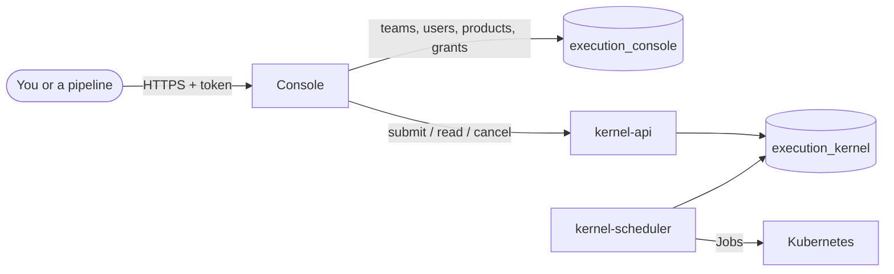
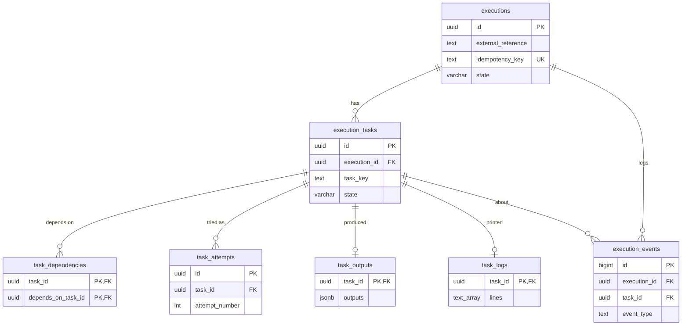
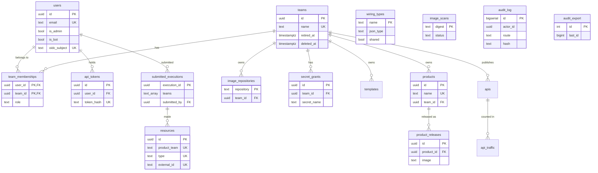

# Where Vertra keeps its data

Vertra has two PostgreSQL databases, one per service, and neither service ever reads the other's:

- **The kernel's** (`execution_kernel`) holds the work itself: every execution, its tasks, their attempts, outputs, logs and events. The kernel knows nothing about people or teams beyond the namespace each task runs in.
- **The console's** (`execution_console`) holds who may do what: teams, users, bots and their tokens, registered products, which secrets each team has, and which teams can see which execution.

The two meet at one value: an execution's id. The kernel creates it; the console records it in `submitted_executions`, with the teams allowed to see it.

Times are all `timestamptz` (stored in UTC). Ids are UUIDs unless noted.

## The kernel database (`execution_kernel`)

Deleting an execution deletes everything under it (every foreign key is `ON DELETE CASCADE`). States are plain `varchar` columns with a check, not Postgres enums, so adding a state is an ordinary migration.

### executions

One row per submitted DAG.

| Column | Type | Null | Meaning |
| --- | --- | --- | --- |
| `id` | uuid | no | The execution id every API call uses. |
| `external_reference` | text | no | The DAG's `name`. The column kept its old name when the API field was renamed. |
| `idempotency_key` | text | no, unique | The DAG's `requestId`. The console prefixes it with the submitting teams (`team-a+team-b/<requestId>`) so two teams can't collide; without one, it's a random UUID. A second submission with the same key returns this execution instead of creating another. |
| `requested_by` | text | yes | Who submitted it, in the console's terms (`user:<id>`), recorded on each task's first attempt. The kernel never resolves it. |
| `state` | varchar | no | `PENDING` → `RUNNING` → `SUCCEEDED`, `FAILED` or `CANCELLED`. |
| `created_at`, `updated_at` | timestamptz | no | |

### execution_tasks

One row per task in a DAG, and the scheduler's work queue: it claims rows from here.

| Column | Type | Null | Meaning |
| --- | --- | --- | --- |
| `id` | uuid | no | Internal id. |
| `execution_id` | uuid | no | The execution it belongs to. |
| `task_key` | text | no | The task's `id` in the DAG; unique within its execution. |
| `image`, `action` | text | no | What runs: the container image, and the action passed as its argument. |
| `team` | text | no | The namespace the task's Job runs in. |
| `service_account` | text | no | The Pod's identity in that namespace. |
| `secret_refs` | text[] | no | Kubernetes Secrets to mount at `/platform/secrets/<name>`. |
| `token_audiences` | text[] | no | Audiences its Pod gets a projected ServiceAccount token for, at `/platform/tokens/<audience>`: its product's `tokenAudiences`, set by the console. |
| `input_schema` | jsonb | yes | Its product's input schema, as the console attached it: its resolved inputs are checked against it before it starts, failing with `INPUT_INVALID`. Empty: not checked. |
| `output_schema` | jsonb | yes | Its product's output schema: its outputs are checked against it when it finishes, failing with `OUTPUT_INVALID`. Empty: not checked. |
| `concurrency_scope` | text | yes | Whose concurrency key it has (its product); null: it never waits for another task. |
| `concurrency_inputs` | text[] | no | The inputs naming what it changes (product.yaml's `concurrencyKey`). |
| `concurrency_key` | text | yes | Its key, worked out from its resolved inputs when it's claimed: while a task with this key is claimed or running, another with it waits, READY. |
| `next_attempt_requested_by` | text | yes | Who retried it, for its next attempt; cleared when that attempt is claimed. |
| `approval_required` | boolean | no | It waits in `AWAITING_APPROVAL`, instead of becoming `READY`, until a maintainer of its team approves it. The console sets it from product.yaml's `approval` and the owning team's `allowedTargets`. |
| `approved_by`, `approved_at` | text, timestamptz | yes | Who approved it (`user:<id>`) and when. Kept across retries, so an approved step isn't asked about again. |
| `resources` | jsonb | yes | The task's own Pod size: `cpu`, `memory` and `memoryLimit`, as Kubernetes quantities. Null, or a part left out, means the deployment's default (`TASK_DEFAULT_RESOURCES`). |
| `state` | varchar | no | `BLOCKED` (waiting on dependencies), `AWAITING_APPROVAL` (waiting for a person to approve it), `READY`, `CLAIMED` (a scheduler took it), `RUNNING` (its Job exists), then `SUCCEEDED`, `FAILED` or `CANCELLED`. |
| `original_inputs` | jsonb | no | The inputs as submitted, `$fromTask` references included. |
| `resolved_inputs` | jsonb | yes | The inputs actually sent, with references replaced by upstream outputs. Set at dispatch. |
| `timeout_seconds` | integer | no | How long one attempt may run. |
| `max_attempts` | integer | no | Attempts allowed for a retryable failure. |
| `attempt_count` | integer | no | Attempts started so far. |
| `dispatch_failures` | integer | no | Starts of the current attempt that raised in a row (an API timeout, say). Each retries the same attempt, so its Job name, adopting what the failed start left; past the scheduler's limit the attempt fails. Back to 0 once a start succeeds. |
| `lease_owner` | text | yes | Which scheduler holds the task while `CLAIMED`/`RUNNING`. |
| `lease_expires_at` | timestamptz | yes | If this passes (the scheduler died or was replaced), another scheduler takes the task over: it keeps watching a running task's Job, and a task that hadn't started yet goes back to `READY`. |
| `available_at` | timestamptz | no | When the task may be claimed: when it became `READY`, or later for an automatic retry (the backoff). Schedulers claim the oldest first. While `AWAITING_APPROVAL`, since when it has waited: it fails with `APPROVAL_EXPIRED` after the scheduler's approval timeout. |
| `executor_handle` | jsonb | yes | Where the current attempt runs: `{"namespace", "jobName"}`. |
| `failure` | jsonb | yes | Why it failed: `{"code", "message", "retryable"}`. |
| `created_at`, `updated_at` | timestamptz | no | |

Indexed on `(state, available_at)`, which is exactly the scheduler's "next READY task" query.

### task_dependencies

The DAG's edges: `task_id` waits for `depends_on_task_id`. A table rather than a JSON list, so "have all of this task's dependencies succeeded?" is a join.

| Column | Type | Null | Meaning |
| --- | --- | --- | --- |
| `task_id` | uuid | no | The waiting task. |
| `depends_on_task_id` | uuid | no | The task it waits for. Indexed, to find a finished task's dependents. |

### task_attempts

The retry history: one row per attempt. `execution_tasks.attempt_count` is the live counter.

| Column | Type | Null | Meaning |
| --- | --- | --- | --- |
| `id` | uuid | no | |
| `task_id` | uuid | no | |
| `attempt_number` | integer | no | 1, 2, …; unique per task. |
| `executor_handle` | jsonb | yes | That attempt's Job. |
| `started_at`, `completed_at` | timestamptz | yes | |
| `failure` | jsonb | yes | That attempt's failure, if it failed. |
| `requested_by` | text | yes | Who asked for this attempt: the submitter for a first attempt, whoever retried it, or null for an automatic retry. |
| `trigger` | text | yes | `submitted`, `retried` or `automatic_retry`. |
| `acted_as` | text | yes | The identity it ran as: `<team>/<serviceAccount>`. |
| `image` | text | yes | The image it ran, pinned to its digest. |

### task_outputs

A task's outputs (from its `result.json`), which downstream `$fromTask` inputs read. One row per task; a retry overwrites it.

| Column | Type | Null | Meaning |
| --- | --- | --- | --- |
| `task_id` | uuid | no | |
| `outputs` | jsonb | no | The `outputs` object the container wrote. |
| `created_at` | timestamptz | no | |

### task_logs

What the task's container printed, refreshed while it runs. Kept here because the kernel deletes a task's Job and Pod once its result is committed. One row per task, overwritten by each attempt.

| Column | Type | Null | Meaning |
| --- | --- | --- | --- |
| `task_id` | uuid | no | |
| `lines` | text[] | no | stdout and stderr, combined, one line per element. |
| `created_at` | timestamptz | no | |

### execution_events

An append-only log of everything that happened to an execution, in order. It's what the console's event timeline shows.

| Column | Type | Null | Meaning |
| --- | --- | --- | --- |
| `id` | bigint | no | Increasing, so it orders events exactly. |
| `execution_id` | uuid | no | |
| `task_id` | uuid | yes | Set for task events. |
| `event_type` | text | no | `EXECUTION_CREATED`, `EXECUTION_STARTED`, `EXECUTION_SUCCEEDED`, `EXECUTION_FAILED`, `EXECUTION_CANCELLED`, `EXECUTION_RESUMED`, `TASK_CLAIMED`, `TASK_STARTED`, `TASK_SUCCEEDED`, `TASK_FAILED`, `TASK_CANCELLED`, `TASK_RETRIED`. |
| `payload` | jsonb | no | Details for that event, such as a failure. |
| `created_at` | timestamptz | no | |

`schema_migrations` also exists: which of `kernel/internal/migrate/sql/` the database has (`kernel migrate`).

## The console database (`execution_console`)

A team's name is also its Kubernetes namespace; there is no separate column for it. `submitted_executions.teams` holds team *names*, which is why a purged team's row is kept: a new team reusing the name would otherwise see the old team's executions.

### teams

| Column | Type | Null | Meaning |
| --- | --- | --- | --- |
| `id` | uuid | no | |
| `name` | text | no, unique | The team, and its namespace. |
| `created_at` | timestamptz | no | |
| `retired_at` | timestamptz | yes | Set when the team is retired: read-only, products unregistered. Clearing it brings the team back. |
| `deleted_at` | timestamptz | yes | Set when a retired team is purged: memberships, grants and products are gone and the team is hidden, but the row stays so the name stays reserved. |
| `from_catalog` | boolean | no | Made by a catalog release: retired when a release no longer names it. A team an admin made isn't touched. |
| `require_sso` | boolean | no | Its members sign in with single sign-on only: their passwords, and sessions a password made, are refused (admins' aren't). No effect while single sign-on is off. |
| `allowed_targets` | jsonb | no | team.yaml's `allowedTargets` from the release: `[{ teams, targets: { "gcp.project": [values or patterns], ... }, approval? }]`, where other teams may aim this team's products; a rule with `approval: true` lets its targets through only with a maintainer's approval. Empty: nowhere. |
| `contact`, `help_chat`, `help_url` | text | yes | team.yaml's `contact` and `help` (`chat`, `url`), from the release: whom to ask when one of its steps fails. |

### users

People and bots alike.

| Column | Type | Null | Meaning |
| --- | --- | --- | --- |
| `id` | uuid | no | |
| `email` | text | no, unique | A bot's is made up, such as `team-a-release-pipeline@bots.vertra.local`. |
| `password_hash` | text | yes | An argon2 hash. Empty for bots, which use tokens, and for people who sign in only through single sign-on. |
| `is_admin` | boolean | no | A platform admin: may act on every team and use the Admin page. |
| `is_bot` | boolean | no | A machine identity, which signs in only with an API token. |
| `password_changed_at` | timestamptz | yes | Sessions issued before this are rejected, so changing a password signs out every other session. |
| `must_change_password` | boolean | no | Its password was set by someone else (an admin's new account or reset, `vertra admin reset-password`): a session it signs in may only change it. |
| `oidc_subject` | text, unique | yes | The single sign-on account bound at the first sign-in through it (`<issuer> `): from then on only that account signs in as this person. |
| `last_signed_in_at` | timestamptz | yes | Its last sign-in, with a password or single sign-on; empty if it never has. Shown on the Admin page's list of people. |
| `created_at` | timestamptz | no | |

### team_memberships

Who is in which team, and as what. Any member sees the team's executions, logs and Pods, and runs its actions; a maintainer also manages its members, secrets and bots and submits raw DAGs for it.

| Column | Type | Null | Meaning |
| --- | --- | --- | --- |
| `user_id` | uuid | no | |
| `team_id` | uuid | no | |
| `role` | text | no | `maintainer` or `member`. Memberships from before roles are maintainers. |
| `created_at` | timestamptz | no | |

### api_tokens

Tokens for bots: a team's bots (Team page → Automation) and the catalog's automation token.

| Column | Type | Null | Meaning |
| --- | --- | --- | --- |
| `id` | uuid | no | |
| `user_id` | uuid | no | The bot it signs in as. |
| `token_hash` | text | no, unique | SHA-256 of the token. The token itself is shown once and never stored. |
| `label` | text | no | What uses it, for people reading the Team page. |
| `scopes` | text[] | no | For an automation token only, its platform-wide permissions, such as `teams:create` or `products:register`. Empty for a team's bot, whose access comes from its team. |
| `created_at` | timestamptz | no | |
| `revoked_at` | timestamptz | yes | Set when revoked; the token stops working at once. |
| `last_used_at` | timestamptz | yes | When it last signed a request in (updated at most every few minutes). |

### products

What a DAG step can run: one row per image and action.

| Column | Type | Null | Meaning |
| --- | --- | --- | --- |
| `id` | uuid | no | |
| `name` | text | no, unique | |
| `image` | text | no | The current image, the one CI registered last. |
| `action` | text | no | Unique together with `image`. |
| `team_id` | uuid | yes | The owning team. Empty for a platform-provided product. |
| `input_schema` | jsonb | no | The inputs the action takes, as JSON Schema: what its order form is built from. |
| `display_name` | text | yes | The product's name for people, such as *GCP Cloud SQL*. |
| `description` | text | yes | What it does. |
| `output_schema` | jsonb | no | What the action outputs, as JSON Schema, including which wiring types it provides. |
| `service_account` | text | yes | The ServiceAccount its tasks run as, in the owning team's namespace. |
| `required_secrets` | text[] | no | The team secrets it uses: the action's `secretRefs` in `product.yaml`, its bindings. (The column keeps its name from before catalog format v2.) |
| `token_audiences` | text[] | no | Audiences its tasks get a projected ServiceAccount token for, to sign in to another cloud: `tokenAudiences` in `product.yaml`. |
| `resources` | jsonb | yes | The Pod size its tasks get when a task doesn't set its own: `cpu`, `memory`, `memoryLimit` as Kubernetes quantities. Null: the deployment's default. |
| `share_with` | text[] | no | The other teams that may run it or include it in their templates, or `*` for every team; empty, only its own team. Teams it isn't shared with still see it, and can ask for access. |
| `hidden` | boolean | no | `visibility: hidden` in product.yaml: only its own team (and admins) see it; it then has no `share_with`. |
| `source_path` | text | yes | Its product.yaml in the catalog repository, for "Ask for access" links; null when it wasn't registered from a release. |
| `idempotent` | boolean | no | product.yaml's `idempotent`: running it again with the same inputs does no harm. Needed for more than one attempt. |
| `max_attempts` | integer | no | product.yaml's `maxAttempts`: how many times a step of it may run in all. A step gets this, or fewer if its template or DAG asks; one if the product isn't idempotent. |
| `concurrency_key` | text[] | no | product.yaml's `concurrencyKey`: the inputs naming what a step of it changes. The kernel runs one step per set of their values at a time. |
| `examples` | jsonb | no | Examples of running it, from its passing contract tests: `[{ name, inputs, outputs }]`, up to ten. The run form offers them. |
| `check` | text | yes | product.yaml's `check` (the product's): the action that says whether it's ready on this install. Null: none. |
| `plan` | text | yes | product.yaml's `plan`: the action of the same product that says what a step of this one would do. **Preview** runs it. Null: none. |
| `cleanup` | jsonb | yes | product.yaml's `cleanup`: `{ action, inputs }`, the action of the same product that removes a resource its steps report, and its inputs (null: `{"resource": ...}`). Null: nothing removes them. |
| `approval` | text | yes | product.yaml's `approval`: `always`, or `otherTeams` (only when another team runs it). A step of it then waits for a maintainer of its team to approve it. Null: never, unless an `allowedTargets` rule asks. |
| `error_help` | jsonb | no | product.yaml's `errors`: `{ CODE: { means, do } }`, shown when a step fails with that code. |
| `deprecated` | text | yes | Why it's deprecated and what to use instead; null when it isn't. |
| `from_catalog` | boolean | no | Registered from a catalog release: unregistered when a release no longer has it. One an admin registered by hand isn't. |
| `created_at` | timestamptz | no | |

Catalog CI registers all of these from the product's `product.yaml` (the catalog's `docs/product-schema.md` describes it). A registration that leaves one out keeps what's stored. Nothing that runs a task reads them: they're for browsing products, building forms and generating DAGs.

### product_releases

Every image a product has been registered with, so the Products page can list its releases.

| Column | Type | Null | Meaning |
| --- | --- | --- | --- |
| `id` | uuid | no | |
| `product_id` | uuid | no | |
| `image` | text | no | Unique per product: registering the same image again isn't a new release. |
| `registered_at` | timestamptz | no | |

### image_repositories

Which team owns each image repository: the first team to register a product from it. Only that team's products may use it, so no team can register another team's code as its own product and run it with its own ServiceAccount and Secrets. A row stays when its products are deleted, so the repository can't be taken over afterwards; an admin releases it (`ProductService/ReleaseImageRepository`) once no product uses it. Products registered before this table existed get their rows when the console starts, the oldest product of a repository deciding.

| Column | Type | Null | Meaning |
| --- | --- | --- | --- |
| `repository` | text | no | An image without its tag or digest, normalized the way the kubelet reads it (`node` is `docker.io/library/node`). |
| `team_id` | uuid | yes | The owning team; null for the platform (products with no team). |
| `created_at` | timestamptz | no | When it was claimed. |

### audit_log

Who changed what (`src/audit.ts`): one row per call that tried to change something (any method not marked as only reading), allowed or refused, recorded once it's answered. Sign-in and password changes aren't recorded. Admins read it with `AdminService/ListAuditEntries`; each entry is also logged (`event: "audit"`).

| Column | Type | Null | Meaning |
| --- | --- | --- | --- |
| `id` | bigserial | no | Increasing; pages go by it. |
| `at` | timestamptz | no | |
| `actor_id` | uuid | yes | The caller (a user or a bot); null when unauthenticated. |
| `method` | text | no | `RPC` (older rows: POST, PUT, PATCH or DELETE). |
| `route` | text | no | The method, such as `vertra.console.v1.SecretService/PutSecret` (older rows: a REST route pattern, such as `/api/teams/:teamName/secrets/:secretName`). |
| `target` | jsonb | no | The identifying fields of the request (names, teams, images, emails, scopes, reasons); never a secret value, password or token. |
| `status` | integer | no | The answer's status, as HTTP would say it (200, 403, 409, ...): a refusal is recorded too. |
| `request_id` | text | yes | The request's id, as in the logs. |
| `hash` | text | yes | sha256 of the previous entry's hash and this entry's fields, so changing, removing or adding an entry breaks every later hash. Null on entries from before the chain. |

### audit_export

The audit log's write-once copy (`src/auditExport.ts`), one row: how far the copy has gone.

| Column | Type | Null | Meaning |
| --- | --- | --- | --- |
| `id` | integer | no | Always 1. |
| `last_id` | bigint | no | The last entry copied; the next copy starts after it. |
| `last_hash` | text | no | Its hash, which the next copy's chain must follow from. |
| `exported_at` | timestamptz | yes | When the last copy was written. |
| `checked_at` | timestamptz | yes | When the export last looked. |
| `error` | text | yes | Why the last look didn't copy: a broken chain (where), or the bucket. |
| `broken_at` | bigint | yes | The entry where the chain broke at the last look; empty while it holds. |

### image_scans

One security scan verdict per image digest (`src/scanning.ts`). Every image is scanned before it's registered or run, whoever built it, and again daily while it's in use; a failed one (a HIGH or CRITICAL vulnerability with a fix, or a secret in the image) blocks new registrations and runs until a rescan finds it clean or an admin accepts it. The kernel chart's scan policy holds the failed digests, so the cluster refuses them too.

| Column | Type | Null | Meaning |
| --- | --- | --- | --- |
| `digest` | text | no | `sha256:…`. |
| `image` | text | no | The reference it was scanned as. |
| `status` | text | no | `pending` (never scanned yet), `passed`, `failed` or `error` (the scan couldn't run). |
| `findings` | jsonb | yes | Counts (`fixable`, `unfixable`, `secrets`) and up to 25 findings, blocking ones first. |
| `job_name` | text | yes | The scan Job running now, if any. |
| `requested_at` | timestamptz | no | When the last scan was started. |
| `scanned_at` | timestamptz | yes | When the verdict was recorded. |
| `last_used_at` | timestamptz | no | When it was last registered or run; rescans stop 30 days after. |
| `accepted_by`, `accepted_reason`, `accepted_at` | uuid, text, timestamptz | yes | An admin accepted a failed verdict, and why. Cleared by a rescan that finds something new. |

### secret_grants

Which secrets each team has registered, never their values. The values live only in Kubernetes Secrets. Any of the team's registered products may mount any of them, when a step lists it in `secretRefs`; the cluster's identity policy holds the same list.

| Column | Type | Null | Meaning |
| --- | --- | --- | --- |
| `id` | uuid | no | |
| `team_id` | uuid | no | |
| `secret_name` | text | no | The Kubernetes Secret's name in the team's namespace. Unique per team. |
| `keys` | text[] | no | The keys inside the Secret. |
| `source` | text | no | `literal` (a value was pasted in) or `external` (synced by External Secrets from a cloud secret store). |
| `created_at`, `updated_at` | timestamptz | no | |

### wiring_types

The catalog's wiring vocabulary, from its `schema/types.yaml`: the names a product's input uses to say what it needs (`x-vertra-needs`) and an output what it provides (`x-vertra-provides`), such as `gcp.project`. A generated DAG connects a needing input to a providing output through these. An admin replaces the whole set (`ProductService/SetWiringTypes`).

| Column | Type | Null | Meaning |
| --- | --- | --- | --- |
| `name` | text | no | The type, such as `gcp.cloudsql.connection`. |
| `json_type` | text | no | The value's JSON type: `string`, `integer`, `number` or `boolean`. |
| `description` | text | no | What a value of this type is. |
| `shared` | boolean | no | When nothing in an order provides it, asked once for the whole order instead of once per product. |
| `default_provider` | text | yes | `<team>/<product>.<action>` added to an order automatically when a required input needs this type and nothing provides it. |
| `updated_at` | timestamptz | no | |

### catalog_sync

The catalog release this console last applied (its teams, products and SecretStores), and how its last look went. One row. The console reads the release from the registry every few minutes and on **Sync now** (Admin page), verifies its signature where the install trusts one, and applies a new one.

| Column | Type | Null | Meaning |
| --- | --- | --- | --- |
| `id` | integer | no | Always 1. |
| `digest` | text | yes | The release applied: its artifact's digest. |
| `commit` | text | yes | The catalog commit it describes. |
| `repository` | text | yes | The catalog repository, for people. |
| `applied_at` | timestamptz | yes | When it was applied. |
| `problems` | jsonb | no | What applying it couldn't do, one item each (`item`, `message`); the rest was applied. |
| `checked_at` | timestamptz | yes | The last look. |
| `error` | text | yes | Why the last look failed (reading or verifying the release); nothing was applied then. |

### templates

What a consumer runs, filling in only parameters: each team's `dags/*.yaml` of kind `Template`, from the catalog's release (which removes them too). Running one builds a DAG from the products its steps name: each step runs its product's latest image, as the product's ServiceAccount, with its action's own secrets, in its team's namespace. Deleted with its team.

| Column | Type | Null | Meaning |
| --- | --- | --- | --- |
| `id` | uuid | no | |
| `team_id` | uuid | no | Its team (`teams.id`); unique with `name`. |
| `name` | text | no | Its file's name. |
| `display_name` | text | no | |
| `description` | text | no | |
| `parameters` | jsonb | no | A JSON Schema for an object: what the person running it fills in, checked before it runs. |
| `steps` | jsonb | no | Its steps: each one's `id`, `action` (`<team>/<product>.<action>`), and optionally `dependsOn`, `inputs` (values, `{"$param": ...}`, `{"$fromStep": ..., "$output": ...}`), `timeoutSeconds`, `maxAttempts`. |
| `share_with` | text[] | no | The other teams that may run it, or `*` for every team; empty, only its own. |
| `hidden` | boolean | no | Only its own team (and admins) see it; it then has no `share_with`. |
| `source_path` | text | yes | Its file in the catalog repository (`teams/<team>/dags/<name>.yaml`). |
| `deprecated` | text | yes | What to use instead; it still runs. |
| `updated_at` | timestamptz | no | |

### apis

API products (decision 20): a backend a team runs, published through the gateway, which forwards only what its OpenAPI document describes. Each team's `apis/<name>/api.yaml`, from the catalog's release (which removes them too); the gateway reads this table. Deleted with its team.

| Column | Type | Null | Meaning |
| --- | --- | --- | --- |
| `id` | uuid | no | |
| `team_id` | uuid | no | Its team (`teams.id`); unique with `name`. Callers reach it at `/<team>/<name>/` on the gateway. |
| `name` | text | no | Its folder's name. |
| `display_name` | text | no | |
| `description` | text | no | |
| `openapi` | jsonb | no | Its OpenAPI document (3.0 or 3.1, references inside it only): the allowlist the gateway enforces, and what callers are shown. |
| `backend_url` | text | no | Where the gateway forwards. Its host must be one of the gateway's `backendHosts`, or the API is held. |
| `backend_auth` | jsonb | yes | How the gateway signs in there: `{"serviceAccountToken": {audience}}`, `{"googleIdToken": {serviceAccount, audience}}` or `{"awsSigV4": {roleArn, region, service}}`, each minted per request from the API's ServiceAccount. Null: it doesn't. |
| `service_account` | text | no | The ServiceAccount, in the team's namespace, its backend credentials are minted for; the console creates it. |
| `share_with` | text[] | no | The other teams that may call it, or `*` for every team; empty, only its own. |
| `hidden` | boolean | no | Only its own team (and admins) see it; it then has no `share_with`. |
| `deprecated` | text | yes | What to use instead; it still answers. |
| `internet` | boolean | no | Asked to be reachable from the internet; published there only if the gateway's `internetTeams` includes its team. |
| `per_minute` | jsonb | no | Requests a minute per calling team: `default`, and teams by name. |
| `timeout_seconds` | integer | no | How long the backend has to start answering. |
| `max_request_bytes` | integer | no | The largest request body forwarded. |
| `source_path` | text | yes | Its `api.yaml` in the catalog repository. |
| `paused_message` | text | yes | Set while a maintainer has it paused: every caller gets 503 with this, and nothing is forwarded. |
| `paused_by` | uuid | yes | Who paused it (`users.id`; null if since deleted). |
| `updated_at` | timestamptz | no | |

### api_traffic

What the gateway did with each API's requests, a minute at a time; it adds to this every 30 seconds, and nothing else writes it. No caller's identity, body or header is kept. Kept a week. Deleted with its API.

| Column | Type | Null | Meaning |
| --- | --- | --- | --- |
| `api_id` | uuid | no | The API (`apis.id`). With `minute`, `team`, `endpoint` and `outcome`, the key. |
| `minute` | timestamptz | no | The minute, in UTC. |
| `team` | text | no | The calling team; empty for a caller who wasn't signed in. |
| `endpoint` | text | no | The operation it matched (`GET /orders/{orderId}`), or for one it didn't, `METHOD /path` as sent, without the query (up to 160 characters). |
| `outcome` | text | no | `forwarded_2xx` to `forwarded_5xx` (the backend's answer), or what the gateway answered itself: `blocked` (not in the spec), `invalid`, `limited`, `unauthenticated`, `forbidden`, `paused`, `held`, `closed`, `unavailable`, `backend_error`. |
| `count` | integer | no | How many. |
| `duration_ms` | bigint | no | Their total time, for averages. |

### gateway_state

The gateway as a whole: one row (`id` 1), which the gateway reads every few seconds.

| Column | Type | Null | Meaning |
| --- | --- | --- | --- |
| `id` | integer | no | Always 1. |
| `closed_message` | text | yes | Set while an admin has the gateway closed: every API answers 503 with this, and nothing is forwarded. |
| `closed_by` | uuid | yes | Who closed it (`users.id`; null if since deleted). |
| `closed_at` | timestamptz | yes | When. |

### submitted_executions

The console's record of every execution submitted through it, and who may see it. The kernel has no idea who submitted what.

| Column | Type | Null | Meaning |
| --- | --- | --- | --- |
| `execution_id` | uuid | no | The kernel's execution id. |
| `teams` | text[] | no | Every team named by a task in the DAG. Members of any of them can see the execution. |
| `submitted_by` | uuid | yes | The user or bot. Emptied if that account is deleted; the record stays. |
| `external_reference` | text | no | The DAG's `name`. |
| `payload` | jsonb | yes | The DAG as sent to the kernel, so **Rerun** can resubmit it. Empty for rows from before this column existed. |
| `template` | text | yes | Run from a template (`TemplateService`): `<team>/<template>`, or `<team>/<product>.<action>` for an action run alone, or `cleanup` for a run deleting resources (`ResourceService`), or `preview` for a run of plan actions (Preview), or `check` for a product's readiness check (run by the console: no `submitted_by`). Whoever ran it can see, cancel, retry and rerun it (not a cleanup's: it's asked for again from the resources); a rerun runs the template again. Empty for a DAG submitted as such. |
| `template_parameters` | jsonb | yes | The parameters it ran with. |
| `on_behalf_of` | text | yes | Which of the submitter's teams it ran for, when the template is shared with specific teams (or the submitter named one). |
| `created_at` | timestamptz | no | |
| `schedule_id` | uuid | yes | The schedule that started it, if one did. |
| `resources_recorded_at` | timestamptz | yes | When what it made, and deleted, was recorded in `resources`, once it finished. Emptied when it's retried, to be recorded again. |

### resources

What runs made: each resource a step reported in its outputs (`resources: [{type, id, name, link}]`), copied when its run finished with that step's resolved inputs and outputs, so it can be deleted after the run itself is gone. References only: whether it still exists is for its product's cloud to say. A later step reporting the same one updates it.

| Column | Type | Null | Meaning |
| --- | --- | --- | --- |
| `id` | uuid | no | |
| `product` | text | no | The registered product whose step reported it (`<team>-<product>-<action>`). Its current `cleanup` deletes it. |
| `product_team` | text | no | That product's team. With `type` and `external_id`, unique. |
| `type` | text | no | What it is, as the product says: such as `gcp/project`. |
| `external_id` | text | no | Its id there. |
| `name` | text | yes | A name for people. |
| `link` | text | yes | An http(s) link to it. |
| `owner_team` | text | yes | The team the run was for: a template's or action's run's `on_behalf_of` (null when it was for the person alone), a DAG's step's team. Its members may delete it. |
| `owner_user_id` | uuid | yes | Who ran it; they may delete it too. Emptied if the account is deleted. |
| `execution_id` | uuid | no | The run whose step last reported it. |
| `task_id` | text | no | That step. |
| `inputs` | jsonb | no | What that step was given, resolved. |
| `outputs` | jsonb | no | What it gave. |
| `position` | integer | no | The step's place in its run, for deleting a run's resources in reverse. |
| `first_reported_at` | timestamptz | no | |
| `reported_at` | timestamptz | no | |
| `deleting_execution_id` | uuid | yes | The last delete asked for: the cleanup run. Deleting while that run is unfinished; failed once it finished without deleting it. |
| `deleting_task_id` | text | yes | Its step for this resource. |
| `delete_requested_by` | uuid | yes | Who asked. |
| `deleted_at` | timestamptz | yes | When its cleanup step succeeded. |

### bot_identities

Who a bot is when it signs in without a stored token (`auth/keyless.ts`): a CI's OIDC issuer and the exact claims its ID token must carry.

| Column | Type | Null | Meaning |
| --- | --- | --- | --- |
| `id` | uuid | no | |
| `bot_id` | uuid | no | The bot. |
| `issuer` | text | no | An issuer the install allows (`keyless.issuers`): GitHub Actions', GitLab's. With `claims`, unique. |
| `claims` | jsonb | no | Each claim the token must carry, with exactly this value: `repository` (or `project_path`, `sub`), and perhaps `ref` or `environment`. |
| `created_by` | uuid | yes | |
| `created_at` | timestamptz | no | |
| `last_used_at` | timestamptz | yes | When a token last signed in with it. |

### schedules

A team's schedules: a template or action run on a cron, with set parameters, for the team, as one of its bots (`scheduleRunner.ts`). The bot's rights are checked when it's made or changed, and on every run.

| Column | Type | Null | Meaning |
| --- | --- | --- | --- |
| `id` | uuid | no | |
| `team_id` | uuid | no | Whose. With `name`, unique. |
| `name` | text | no | |
| `kind` | text | no | `template` or `action`. |
| `runnable_team` | text | no | The template's or action's team. |
| `runnable_name` | text | no | The template's name, or the action's registered product name. |
| `parameters` | jsonb | no | What it runs with. |
| `cron` | text | no | Five fields: minute, hour, day of the month, month, day of the week. At most every five minutes. |
| `time_zone` | text | no | An IANA time zone the cron is read in. |
| `bot_id` | uuid | no | The team's bot it runs as; deleting the bot deletes the schedule. |
| `enabled` | boolean | no | False while paused. |
| `next_run_at` | timestamptz | yes | When it runs next; null while paused. A console starting it moves this on first, so only one does. |
| `last_run_at` | timestamptz | yes | |
| `last_execution_id` | uuid | yes | Its last run. |
| `last_error` | text | yes | Why its last start was refused. |
| `created_by` | uuid | yes | |
| `created_at` | timestamptz | no | |

### product_readiness

Whether each product is ready on this install: its check action's last answer (`readiness.ts`).

| Column | Type | Null | Meaning |
| --- | --- | --- | --- |
| `product` | text | no | The check action's registered name (`<team>-<product>-<check>`), for its whole product. |
| `product_team` | text | no | |
| `image` | text | no | The image checked: a new one is checked again. |
| `state` | text | no | `checking`, `ready`, `not_ready`, or `failed` (the check couldn't say). |
| `execution_id` | uuid | yes | The check run. |
| `principal` | text | yes | What it acts as here. |
| `missing` | text[] | no | What it lacks. |
| `detail` | text | yes | |
| `requested_at` | timestamptz | no | When the check was asked for. |
| `checked_at` | timestamptz | yes | When it answered. |

### notification_events

Something worth telling people: a run that failed or finished, a step waiting for an approval, the catalog not being pulled. Made once, then shown in people's inboxes and posted to teams' chat webhooks. Kept 90 days.

| Column | Type | Null | Meaning |
| --- | --- | --- | --- |
| `id` | uuid | no | |
| `key` | text | no | What makes it the same event (`run:<id>:<state>:<finished at>`, `approval:<run>:<step>:<since>`, `catalog:<last applied>`). Unique, so it's only ever made once. |
| `kind` | text | no | `run_failed`, `run_succeeded`, `approval_waiting`, `catalog_failing` or `product_not_ready`. |
| `title` | text | no | |
| `body` | text | no | |
| `link` | text | yes | The console page it's about, such as `/runs/<id>`. |
| `created_at` | timestamptz | no | |

### user_notifications

A person's copy of an event: their inbox.

| Column | Type | Null | Meaning |
| --- | --- | --- | --- |
| `event_id` | uuid | no | The event. |
| `user_id` | uuid | no | Whose. |
| `read_at` | timestamptz | yes | When they read it; empty while unread. |

### team_webhooks

A team's chat webhook (Slack, Google Chat, Teams), set by its maintainers.

| Column | Type | Null | Meaning |
| --- | --- | --- | --- |
| `team_id` | uuid | no | |
| `url_encrypted` | text | no | The webhook URL, a credential: AES-256-GCM with a key derived from the console's `JWT_SECRET`. Never sent back by the API. |
| `host` | text | no | Its host, which is what people see. |
| `kinds` | text[] | no | What it gets: `run_failed`, `approval_waiting`, `product_not_ready`. |
| `updated_by` | uuid | yes | Who set it last. |
| `updated_at` | timestamptz | no | |
| `last_sent_at` | timestamptz | yes | The last post that went. |
| `last_error` | text | yes | Why the last one didn't, if it didn't. |

### webhook_deliveries

An event to post to a team's webhook: tried up to five times.

| Column | Type | Null | Meaning |
| --- | --- | --- | --- |
| `event_id` | uuid | no | |
| `team_id` | uuid | no | |
| `attempts` | integer | no | |
| `sent_at` | timestamptz | yes | When it went. |

The console's migrations are tracked in the `drizzle` schema, outside `public`.
