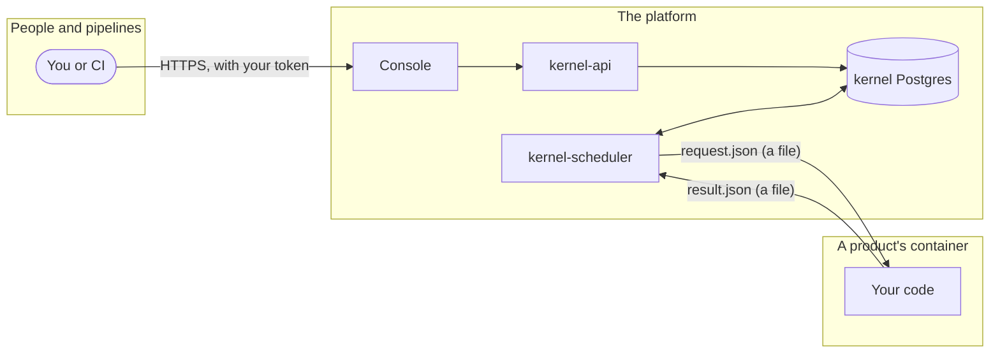
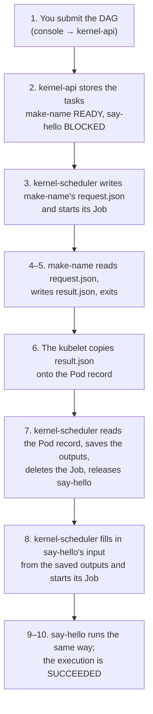

# How a value moves from one task to the next

A DAG's tasks never talk to each other. When one task's output becomes the next task's input, the value goes through several hands on the way, and each hand belongs to a different part of the system. This guide follows one real value, `"Anna Berg"`, through a real run on the kind cluster and shows what it looks like at every stop.

The DAG is the two-task chain from the catalog's templates: **make-name** builds a full name, and **say-hello** greets whoever make-name named.

## First, the words

Half the confusion comes from words that sound alike. This guide uses them like this:

| Word | Means |
| --- | --- |
| **Execution** | One run of a DAG. Has an id, such as `cdf0f66e-…`. |
| **Task** | One step of a DAG, such as `make-name`. |
| **Attempt** | One try at running a task. A retry is a new attempt. |
| **Product** | What a task runs: a container **image**, plus the **action** to run in it, such as `make`. |
| **Team** | A platform team. Its name is also its Kubernetes **namespace**, where its tasks run. |
| **Job** | The Kubernetes object that says "run this container once, to completion". One per attempt. |
| **Pod** | What a Job creates to actually run the container. It exists in two places (see below). |
| **kernel** | Not one thing: two separate programs that share a database. |
| **kernel-api** | Accepts DAGs and answers "how is it going?". Never runs anything. |
| **kernel-scheduler** | Picks up waiting tasks, starts their Jobs, collects their results. Does all the moving in this guide. |
| **API server** | Kubernetes' own front desk, where every Kubernetes object (Jobs, Pods, ConfigMaps) is kept. |
| **kubelet** | Kubernetes' agent on each machine (node). It runs the containers and reports what happened to them. |
| **Inputs / outputs** | What a task is given / what it hands back. |
| **result.json** | The file a product writes to hand back its outputs. |

## Three zones, and what may cross between them



- **People and pipelines** only ever talk to the console.
- **The platform** is the console, kernel-api, kernel-scheduler and their databases. Only it reads or writes the databases.
- **A product's container** is given exactly two things: the file `request.json`, and the secrets its step lists (its platform's, registered in the console), mounted at `/platform/secrets/<name>`. It gives back exactly one: the file `result.json`. It has no password to any Acyclix database and no reason to call the platform. (Kubernetes also mounts the Pod's ServiceAccount token, which Acyclix grants nothing: no Kubernetes API access. A cloud identity bound to the product's ServiceAccount is the platform team's own.)

Everything below is about how a file gets across that last line, in each direction, without the container ever touching the platform.

> The network enforces it too: NetworkPolicies let only the platform's own Pods connect to its databases, and only the console connect to kernel-api, so a container can reach neither. (Its other network traffic isn't restricted.)

## The journey, step by step



### 1. You submit the DAG

**Who:** you (or CI), through the console, which checks you're allowed and passes it on to kernel-api.

say-hello doesn't contain a name. It contains a **reference**: "make-name's output called `name`".

```json
{
  "name": "name-then-hello",
  "tasks": [
    { "id": "make-name", "team": "team-a", "action": "make",
      "image": "localhost:5001/team-a-name-maker-product:latest",
      "serviceAccount": "default",
      "inputs": { "first": "Anna", "last": "Berg" } },
    { "id": "say-hello", "team": "team-a", "action": "greet",
      "image": "localhost:5001/team-a-hello-product:latest",
      "serviceAccount": "default", "dependsOn": ["make-name"],
      "inputs": { "name": { "$fromTask": "make-name", "$output": "name" } } }
  ]
}
```

### 2. kernel-api stores it, and nothing runs yet

**Who:** kernel-api. **Where:** `SubmitExecution` (`kernel/internal/api/service.go`).

kernel-api checks the DAG and saves one row per task in `execution_tasks`. make-name has no dependencies, so it's `READY`. say-hello depends on make-name, so it's `BLOCKED`, with the reference still in its `original_inputs`. kernel-api's job is done: it never starts anything.

| task_key | state | original_inputs |
| --- | --- | --- |
| make-name | READY | `{"first": "Anna", "last": "Berg"}` |
| say-hello | BLOCKED | `{"name": {"$fromTask": "make-name", "$output": "name"}}` |

### 3. kernel-scheduler hands make-name its input as a file

**Who:** kernel-scheduler, about a second later. **Where:** `claimReadyTasks` (`kernel/internal/scheduler/claiming.go`), then the executor's `Start` (`kernel/internal/executor/kubernetes.go`).

The scheduler finds make-name `READY`, claims it, and asks the Kubernetes API server for two objects in the team's namespace, `team-a`:

- a **ConfigMap** holding one file, `request.json`:

  ```json
  {"executionId": "cdf0f66e-3789-47ea-9bab-782e2153b499", "taskId": "make-name",
   "action": "make", "attempt": 1, "inputs": {"last": "Berg", "first": "Anna"}}
  ```

- a **Job** that runs the product's image. The parts that matter, from the real Pod:

  ```yaml
  containers:
    - name: product
      image: localhost:5001/team-a-name-maker-product:latest
      args: ["make"]          # the action
      terminationMessagePath: /platform/output/result.json
      terminationMessagePolicy: File
      volumeMounts:
        # the ConfigMap, read-only:
        - { name: input, mountPath: /platform/input, readOnly: true }
        # an empty folder for result.json:
        - { name: output, mountPath: /platform/output }
  ```

Both are named `ek-make-name-86049a8a6115d0c3`: the task's id, plus a fingerprint of the execution, task and attempt.

### 4–5. The product reads a file and writes a file

**Who:** the product's own code. **Where:** the product, in the catalog (here `templates/name-maker/actions/make.py`).

This is the whole contract between a product and Acyclix. The product knows nothing about databases, Kubernetes or other tasks:

```python
inputs = json.loads(Path("/platform/input/request.json").read_text())["inputs"]
name = f"{inputs['first']} {inputs['last']}".strip()
Path("/platform/output/result.json").write_text(
    json.dumps({"status": "succeeded", "outputs": {"name": name}}))
```

Then the container exits.

### 6. Kubernetes copies the result out of the container

**Who:** the kubelet, Kubernetes' agent on the machine that ran the container.

Here's the detail that makes it all work. A Pod exists in two places:

```
ON THE MACHINE (node)
  the container wrote  /platform/output/result.json
                              │
                              │  the kubelet copies it
                              │  when the container exits
                              ▼
IN THE API SERVER
  the Pod record:  status.containerStatuses[0]
                     .state.terminated.message
```

The **container** is a process on one machine, with its own files. The **Pod record** is a description kept centrally by the Kubernetes API server: what was asked for (`spec`) and what happened (`status`). Because of `terminationMessagePath`, the kubelet copies `result.json` into the record's status when the container exits. This is the real record:

```yaml
status:
  containerStatuses:
    - name: product
      state:
        terminated:
          exitCode: 0
          reason: Completed
          message: '{"status": "succeeded", "outputs": {"name": "Anna Berg"}}'
```

From here on, nobody needs the container: it has exited, and its files go when the Pod is deleted. The result now lives in the Pod record.

### 7. kernel-scheduler reads the record and saves the result

**Who:** kernel-scheduler, on its next tick. **Where:** `poll` (`kernel/internal/scheduler/tick.go`) → the executor's `Status` → `finalize`, `buildStatus`.

The scheduler asks the API server for the Pod record, the same way `kubectl get pod -o yaml` does. It never reaches into the container. It then:

1. **checks** the message: valid JSON, `status` either `succeeded` or `failed`, an `error` only when failed. Anything else fails the task (`PRODUCT_RESULT_MISSING`, `PRODUCT_RESULT_INVALID`). Outputs that contain something shaped like a credential (a private key, a cloud access key, a GitHub token) fail it too (`OUTPUT_CONTAINS_CREDENTIAL`), and the same shapes are blanked out of its logs and error message as `[redacted …]`.
2. **saves** the outputs to Postgres, in `task_outputs`, and the container's printed lines to `task_logs`:

   | task | outputs |
   | --- | --- |
   | make-name | `{"name": "Anna Berg"}` |

3. **deletes** the Job and its ConfigMap. The Pod, its record and the copy of `result.json` go with them, so the database is now the only place the result exists.
4. **releases** say-hello: all of its dependencies have succeeded, so it moves from `BLOCKED` to `READY`.

### 8. kernel-scheduler fills in say-hello's input

**Who:** kernel-scheduler. **Where:** `_dispatch_task` → `input_resolution.resolve_task_inputs`.

Before starting say-hello, the scheduler reads the saved outputs of say-hello's dependencies from Postgres and replaces every reference with the real value:

| | inputs |
| --- | --- |
| as submitted (`original_inputs`) | `{"name": {"$fromTask": "make-name", "$output": "name"}}` |
| as sent (`resolved_inputs`) | `{"name": "Anna Berg"}` |

say-hello's `request.json` therefore carries a plain value, and say-hello never learns where it came from:

```json
{"executionId": "cdf0f66e-3789-47ea-9bab-782e2153b499", "taskId": "say-hello",
 "action": "greet", "attempt": 1, "inputs": {"name": "Anna Berg"}}
```

If the output it needs isn't there (make-name didn't output `name`), say-hello fails with `MISSING_UPSTREAM_OUTPUT` and isn't retried.

### 9–10. The same again, and the execution is done

say-hello runs exactly like make-name: it reads its file and writes its file, the kubelet copies the result, and the scheduler saves it:

```json
{"status": "succeeded", "outputs": {"message": "Hello, Anna Berg!", "secretFound": false}}
```

With every task succeeded, the scheduler marks the execution `SUCCEEDED`. The execution's event log shows the whole run in order:

```
EXECUTION_CREATED
TASK_CLAIMED    make-name
EXECUTION_STARTED
TASK_STARTED    make-name
TASK_SUCCEEDED  make-name
TASK_CLAIMED    say-hello
TASK_STARTED    say-hello
TASK_SUCCEEDED  say-hello
EXECUTION_SUCCEEDED
```

The whole run took about five seconds.

## What this means if you write a product

- Read `/platform/input/request.json`. Write `/platform/output/result.json`, on success and on failure, then exit.
- Keep `result.json` under **4 KB** in total: Kubernetes keeps no more than that in the Pod record. Output small values (IDs, names, URIs). Put large data in your own storage and output where it is (`"reportUri": "gs://…"`).
- Never put a secret in `outputs`: outputs are stored, and anyone who can see the execution can read them.
- Your task can run more than once, for example if a scheduler stops halfway. Make a second run safe.
- You don't need to know who uses your outputs. Another team's DAG can feed your output into their task with `$fromTask`, and neither product changes.

## Questions people ask

**Why doesn't the container just write its result to the database?** It would need the database's password and a network path to it. Any product could then read or change every team's work, and nothing would check what it wrote. A file needs no access at all, and the scheduler checks it before saving anything.

**Can two tasks talk to each other directly?** No. Values only move through the scheduler and Postgres, between a task finishing and the next one starting. Two tasks are never guaranteed to run at the same time, or even on the same machine.

**What if the scheduler stops between reading a result and saving it?** The task's claim (its lease) runs out after a minute, and a scheduler picks the task up again, so it runs again. That's why products must be safe to run twice.

**Where can I see this for my own run?** The execution's page in the console shows each task's state, outputs and logs. To watch the Kubernetes side on kind, run `kubectl -n <team> get configmaps,pods -w`, then submit a DAG; the `ek-…` objects appear and are deleted within seconds.

**Want more?** [What's a DAG?](03-what-is-a-dag.md) explains `dependsOn` and `$fromTask`. [How Acyclix works under the hood](08-under-the-hood.md) lists every Kubernetes feature used here and why. [Where Acyclix keeps its data](06-database-schemas.md) describes the tables named above.
