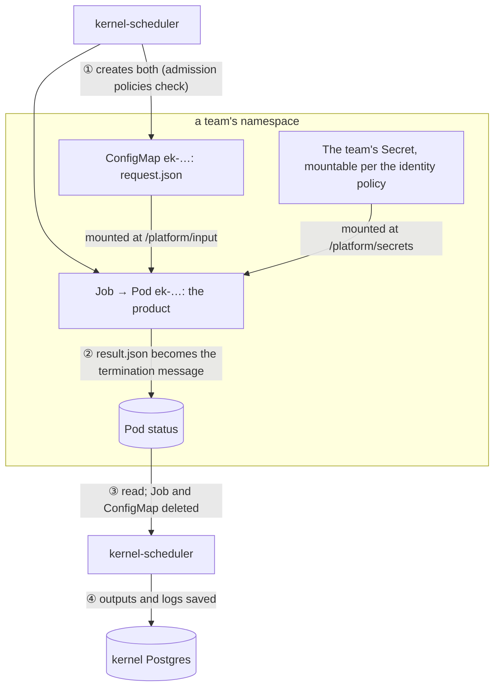

# How Acyclix works under the hood

Acyclix is built from ordinary pieces: Kubernetes, Helm, Postgres, a web app. Many of them are used in ways their manuals don't lead with. This guide lists each one: what the feature is normally for, what Acyclix uses it for, why, and where to find it in the code. Read it with the architecture diagrams in `docs/architecture/` (system, classes, the submit-to-finished sequence, states) and [Where Acyclix keeps its data](06-database-schemas.md).



## Running a task

### A Job per attempt, never retried by Kubernetes
- **Normally:** a Job runs batch work and Kubernetes retries failed Pods for you (`backoffLimit`).
- **Here:** each attempt is its own Job, named `ek-<task>-<fingerprint>`, where the fingerprint is a hash of the execution, task and attempt (Kubernetes names are limited to 63 characters), with `backoffLimit: 0` and `restartPolicy: Never`.
- **Why:** the kernel decides whether to retry, from the product's own `retryable` flag. Every attempt is recorded in `task_attempts` with its own Job, so nothing retries without the kernel knowing.
- **Code:** `kernel/app/executors/kubernetes.py` (`job_name_for`, `_create_job`).

### A ConfigMap as a one-off input file
- **Normally:** a ConfigMap holds an application's settings.
- **Here:** each task gets a ConfigMap named after its Job, holding a single file, `request.json` (execution id, task id, action, attempt, and the inputs with every `$fromTask` reference already replaced by a real value). It's mounted read-only at `/platform/input` and deleted with the Job.
- **Why:** a team's inputs never pass through a shell command, so they can't inject one, and a product in any language only has to read a file. If the Job itself is refused, the kernel deletes the ConfigMap at once so it isn't left behind.
- **Code:** `_create_config_map`, and `start` for the clean-up.

### The termination message as the output channel
- **Normally:** a container writes a short "why I stopped" note to `/dev/termination-log`.
- **Here:** `terminationMessagePath` points at `/platform/output/result.json`, with `terminationMessagePolicy: File`. When the container exits, the kubelet copies the file into the Pod's status, where the scheduler reads it.
- **Why:** it needs no sidecar, no shared disk, and no database password or network path back to the platform in the product. The product writes a file and exits. [How a value moves from one task to the next](07-how-data-moves.md) follows a real result through every step.
- **Limit:** Kubernetes keeps at most **4096 bytes**, the whole file included. Products should output small values (IDs, names, URIs) and put large data in storage, outputting its URI. Today an oversized file is truncated and fails as `PRODUCT_RESULT_INVALID`.
- **Code:** `_create_job`, `_build_status`.

### An emptyDir as the only writable folder
- **Normally:** scratch space for a Pod.
- **Here:** `/platform/output` is an empty folder that exists only as long as the Pod does. It's the one place the product is meant to write.
- **Code:** `_create_job` (the `output` volume).

### Pod status as an early-warning system
- **Normally:** you watch Pod status for health.
- **Here:** while a Job hasn't finished, the scheduler checks its Pod. If the container has been stuck in `ErrImagePull` or `ImagePullBackOff` for longer than a grace period (120 s by default), or the image name is invalid, the task fails right away.
- **Why:** otherwise a task whose image was deleted would wait out its whole timeout.
- **Code:** `image_pull_failure`, `_image_pull_error`.

### Deleting Jobs eagerly, with a TTL as a backstop
- **Normally:** `ttlSecondsAfterFinished` cleans up finished Jobs after a while.
- **Here:** the scheduler deletes a Job and its ConfigMap the moment it has read the result and logs. The TTL (1 hour) only catches Jobs it missed, for example after a scheduler crash.
- **Why:** each team's namespace stays clean, and nothing is left holding a task's inputs. That's also why logs are copied into Postgres (`task_logs`): the Pod is gone seconds later.
- **Code:** `_finalize`, `_delete_job`.

### Labels as a query index
- **Normally:** labels group and select objects.
- **Here:** every task Pod carries `acyclix.dev/execution-id` and `acyclix.dev/attempt`, plus the annotation `acyclix.dev/task`. The Team page's **Running now** finds a team's live Pods by these labels, straight from Kubernetes, without asking the kernel.
- **Code:** `kubernetes.py` (`_create_job`), `console/src/k8s.ts` (`listTaskPods`).

## Isolation and security

### One namespace per team, with its state in a label
- **Normally:** namespaces separate applications.
- **Here:** a team's name is its namespace's name, and the namespace's label holds the team's state: `acyclix/team=true` while active, `acyclix/team=retired` once retired. Retiring a team is one label change, because the admission policies read the label.
- **Code:** `console/src/core/teams.ts` and `console/src/k8s.ts` (`setTeamNamespace`: the console creates and relabels it), limited by the console chart's `namespace-policy.yaml`; `console/src/db/schema.ts` (no separate namespace column, on purpose).

### Who may mount a Secret is an admission policy, not RBAC
- **Normally:** access to a Secret is RBAC: a Role and a RoleBinding.
- **Here:** RBAC doesn't apply to mounts (the kubelet mounts whatever a Pod names), so no Role is involved. A team's secrets are the ones it registered in the console; the identity policy lets a step mount them only if it's one of the team's registered products, running as the ServiceAccount its product declares. The console keeps the policy's products and each team's secret names current, and creates no RBAC at all (it may only delete the per-secret Roles older versions made).
- **Code:** `console/src/productPolicy.ts`, `helm/charts/execution-kernel/templates/identity-policy.yaml`.

### Admission policies as the last line of defence
- **Normally:** a ValidatingAdmissionPolicy enforces cluster-wide rules, written in CEL and run by the API server itself, with no webhook server to operate.
- **Here:** three policies back up what the console already checks, so a bug in, or a way around, the console still can't cause harm:
  - **dispatch-policy:** the scheduler may create Jobs and ConfigMaps only in namespaces labelled `acyclix/team=true`, never in its own (GKE allows its own for now, until the platform moves out of `default`). `matchConditions` limits the rule to the scheduler's own identity.
  - **image-policy:** a task's image must come from an allowed source.
  - **purge-policy:** a configured purger may delete only a retired team namespace. None by default: a purged team's namespace is left, labelled retired, for a cluster administrator.
- **Errors:** a refusal fails the task with `DISPATCH_REJECTED`, `IMAGE_NOT_ALLOWED` or `IDENTITY_NOT_ALLOWED`, and it isn't retried.
- **Code:** `helm/charts/execution-kernel/templates/*-policy.yaml`.

### The image policy is its own database
- **Normally:** a policy is written once, and any data it needs comes from a parameter object (a ConfigMap).
- **Here:** the allowed image sources are written as literal values inside the image-policy object itself. The Admin page reads them back out (it parses the policy's CEL variables) and writes new ones in. The console checks images with the same rules in TypeScript first, so users get a clear message before Kubernetes ever sees the Job.
- **Why:** on Kubernetes 1.36, once a policy using a ConfigMap parameter had been deleted and recreated, later edits to the ConfigMap stopped taking effect. A security rule can't depend on that.
- **Code:** `image-policy.yaml`, `console/src/imagePolicy.ts`, `console/src/k8s.ts` (`readImagePolicyData`, `writeImagePolicyData`).

### Signed images (GKE)
- **Normally:** images are trusted because they're in your registry.
- **Here:** the catalog's CI signs each product image with a Cloud KMS key, only after it passes its security scans. Sigstore's policy-controller, an admission webhook, refuses unsigned catalog images with `IMAGE_NOT_SIGNED`.
- **Code:** `helm/charts/execution-kernel/templates/image-signature.yaml`, `helm/values/gke/policy-controller.yaml`, the catalog's `ci.yml`.

### Cloud access without keys
- **Normally:** an app reads a downloaded service-account key.
- **Here:** a Kubernetes ServiceAccount annotated with `iam.gke.io/gcp-service-account` acts as that GCP service account through Workload Identity. That's how the console checks Artifact Registry, ESO reads Secret Manager, and backups reach Cloud Storage. GitHub workflows do the same through Workload Identity Federation. No key files exist anywhere.
- **Code:** `helm/values/gke/console.yaml` (`serviceAccount.annotations`).

### Catalog CI with no cluster credentials
- **Normally:** a GitOps pipeline holds credentials to apply what it merges.
- **Here:** the catalog's workflows only call the console with a bot token. The console creates, retires and purges team namespaces and applies a team's reviewed SecretStore file after checking it holds nothing outside that team. Admission policies limit what the console itself may do to namespaces.
- **Code:** `console/src/core/teams.ts`, `console/src/secretStores.ts`, `catalogctl` (`cli/internal/catalogctl/teams.go`: `teams`, `secret-stores`).

### Secrets synced from the cloud
- **Normally:** Secrets are created by hand or by CI.
- **Here:** a team's `SecretStore` says which cloud secret manager to read and as which identity; an `ExternalSecret` says which secret to copy into which Kubernetes Secret. External Secrets Operator keeps them in sync. The Secret it writes is mounted by the same rule as a pasted one: the identity policy.
- **More:** [Secrets, explained from scratch](04-secrets-explained.md), [Sync secrets from GCP Secret Manager](02-sync-secrets-gcp.md).

## Helm

### Migrations as a hook Job
- **Here:** each chart's database migration runs as a Job with `helm.sh/hook: post-install,pre-upgrade`, so the schema is upgraded before new Pods start. `hook-delete-policy` removes the Job once it succeeds.
- **Code:** `helm/*/templates/migration-job.yaml`.

### `lookup` to keep what's already there
- **Here:** during an upgrade, Helm reads the live cluster. The console's generated JWT signing secret is kept, so sessions survive upgrades, and so is the image allowlist the Admin page edited.
- **Code:** `helm/charts/execution-console/templates/secret.yaml`, `helm/charts/execution-kernel/templates/image-policy.yaml`.

### A checksum that restarts Pods
- **Normally:** changing a ConfigMap doesn't restart the Pods that use it.
- **Here:** the console's Deployment carries a hash of its ConfigMap as an annotation. A config change changes the hash, so Kubernetes rolls new Pods.
- **Code:** `helm/charts/execution-console/templates/deployment.yaml` (`checksum/config`).

### Each cluster's settings in one file
- **Here:** `make kind-deploy` and `make gke-deploy` pass `--reset-values`, so whatever was set by hand before is dropped. `helm/values/{kind,gke}/*.yaml` is the whole truth about each cluster.

### Applying around Helm
- **Here:** the backup CronJobs are applied with `helm template … | kubectl apply` instead of `helm upgrade`, working around a Helm bug described at the top of the template.
- **Code:** `helm/*/templates/backup-cronjob.yaml`.

## Postgres

### A database as the only channel between two services
- **Here:** kernel-api and kernel-scheduler never call each other. The API writes rows; the scheduler reads and updates them. If either stops, the other carries on, and nothing is lost in transit.

### A work queue without a queue
- **Normally:** you'd add RabbitMQ, SQS or Redis.
- **Here:** `execution_tasks` is the queue. Each tick, the scheduler selects READY tasks `FOR UPDATE SKIP LOCKED`, so two schedulers never claim the same task, and takes a **lease** (`lease_owner`, `lease_expires_at`, 60 s by default) that it renews while the task runs. If a scheduler dies, its leases expire and another scheduler picks the tasks up.
- **Consequence:** a task can run twice, for example if its scheduler died after starting the Job. Products must be safe to run again.
- **Code:** `kernel/app/scheduler/claiming.py`.

### Idempotency from a unique index
- **Here:** `executions.idempotency_key` (the API's `requestId`) is unique. The kernel checks it first and inserts inside a savepoint; if two identical requests race, the loser's insert fails on the index and it returns the winner's execution instead. The console prefixes the `requestId` with the submitting teams, so two teams can never collide.
- **Code:** `kernel/app/services/execution_service.py` (`submit_execution`), `console/src/core/executions.ts` (`scopeRequestId`).

### An append-only event log
- **Here:** every state change also writes a row to `execution_events`, numbered by an increasing id, so an execution's history is exact and in order even if timestamps tie.

### Copies of what Kubernetes throws away
- **Here:** outputs (`task_outputs`) and logs (`task_logs`) are copied out of the Pod before its Job is deleted. Between deleting the Job and committing those rows, the executor keeps the result in memory, so a failed commit can be retried on the next tick.

## The console

### A front door for a back end that has no locks
- **Here:** kernel-api accepts calls only from the console (by its ServiceAccount token) and knows nothing about users or teams. The console does all of it: it checks membership, secret grants, retired teams and images, then forwards the request. `submitted_executions` records which teams may see each execution, since the kernel can't say.
- **Consequence:** kernel-api must only be reachable inside the cluster.

### One API, two kinds of credential
- **Here:** people sign in for a session token (a JWT); bots use API tokens, which start with `mp_`. The prefix decides how a request is checked, with no "try one, fall back to the other". Either way, the request ends up as the same user with the same team checks.
- **Details:** a session issued before the user's last password change (`users.password_changed_at`) is rejected, so changing a password signs out every other session. Token use is recorded at most every 5 minutes, to avoid a database write per request. Passwords use argon2, deliberately slow; tokens use SHA-256, since a random 256-bit token can't be guessed anyway.
- **Code:** `console/src/auth/plugin.ts`, `apiToken.ts`, `password.ts`.

### Login that gives nothing away
- **Here:** a login for an email that doesn't exist still checks the password against a dummy hash, so a wrong guess takes the same time either way and response times don't reveal which emails exist. After 10 failures in an hour for one IP and email, each further attempt must wait. On GKE the console's Service uses `externalTrafficPolicy: Local`, so it sees each client's real IP instead of a node's, and one attacker can't lock everyone out.
- **Code:** `console/src/auth/password.ts` (`verifyAgainstNothing`), `loginThrottle.ts`, `helm/values/gke/console.yaml`.

### Errors that don't leak the cluster
- **Here:** one global error handler turns every server error into a generic message, because Kubernetes client errors carry cluster responses and headers. Routes don't catch errors themselves.
- **Code:** `console/src/index.ts` (`setErrorHandler`).

### Checking an image exists before running it
- **Here:** before a submission or rerun, the console asks the registry whether each image still exists, using the registry's own HTTP API and its token handshake (a short-lived Workload Identity token on GKE). Answers are cached for a minute. A missing image is refused up front (`IMAGE_NOT_FOUND`) instead of failing later in the cluster.
- **Code:** `console/src/registry.ts`.

### One origin, no CORS
- **Here:** the same process serves the React app and the API, with every API method under `/api`. The browser only ever talks to one origin, so there's no cross-origin setup to get wrong.
- **Code:** `console/src/index.ts`.

### An API defined by its protos
- **Here:** the API is a set of Connect services, defined in protobuf (`proto/acyclix/console/v1`): the console serves them, and its pages, `acyclixctl` and `catalogctl` call them through clients generated from the same files, so a change to the contract shows up as a compile error in every caller, not a surprise at run time. The [API reference](api-reference.md) is generated from them too, comments included; a test fails if a service or method has no description.
- **Code:** `proto/`, `console/src/rpc/` (serving), `console/src/core/` (what each method does), `console/scripts/api-reference.ts`.

## The catalog pipeline

- **Teams from folders:** a team folder in `acyclix-catalog` becomes a team. `apply-teams` asks the console, which creates the team and its labelled namespace; removing the folder retires it (`retire-teams`); `purge-team` deletes the team, leaving its namespace labelled retired for a cluster administrator to delete.
- **Scan, then sign:** catalog CI builds each product, scans it, pushes it, and only then signs it with the KMS key, so "signed" means "passed the scans".
- **Least-privilege CI:** each workflow signs in to GCP through Workload Identity Federation as its own service account. Purging requires a dedicated GitHub Environment, and a policy lets only that identity delete namespaces.
- **Products register themselves:** CI registers each product (image and action) with the console using an automation token whose scopes allow only what CI needs.

## See it for yourself (kind)

```console
$ K="kubectl --context kind-acyclix-local"
$ $K get ns -L acyclix/team                          # team state as labels
$ $K get validatingadmissionpolicy kernel-execution-kernel-identity -o yaml   # products, team secrets
$ $K get validatingadmissionpolicy                   # the admission policies
$ $K get jobs,configmaps -A -w | grep ek-            # run a DAG and watch tasks come and go
```

Catch a task's Job before it's deleted with `$K -n <team> get job <name> -o yaml`: its labels, `backoffLimit: 0`, `terminationMessagePath` and volumes are all in one place.
